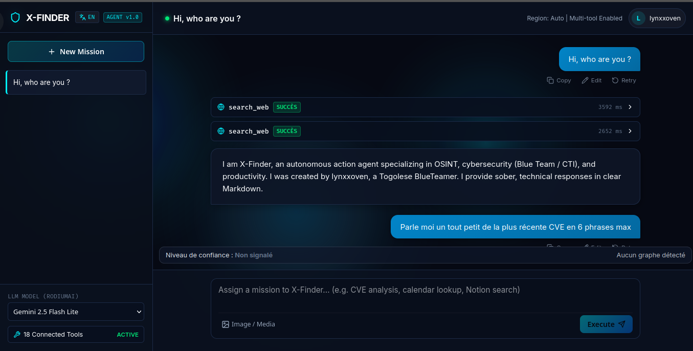

# 🛡️ X-Finder : Agent IA Personnel Autonome avec Tool Calling (RodiumAi Bootcamp - Module 6)

> 🚀 **Application déployée : [Ouvrir X-Finder](https://x-finder-api.onrender.com/)**

> **Assignment de cours** : Développer un agent IA personnel capable d'utiliser des outils externes pour effectuer des tâches concrètes à la demande de l'utilisateur.  
> **Spécialité X-Finder** : OSINT (Open Source Intelligence), Cyber Threat Intelligence (CTI), Détection d'Opportunités (Stages, Emplois, Hackathons, CTF) & Recherche Multimodale (Texte + Image).  
> **Auteur** : Kokou Olivier FIABI (`lynxxoven`)  
> **Plateformes supportées** : Linux, Windows, macOS  
> **Fournisseur LLM** : RodiumAI (`https://api.rodiumai.io/v1`) — Modèles : Gemini 2.5 Flash Lite, Gemini 3.8 Flash, Claude 3.5 Sonnet  

---

## Aperçu de l'application



### Interface principale
L'écran principal regroupe la conversation avec l'agent, la sélection du modèle et les outils disponibles.

### Investigation et résultats
<!-- Ajouter ici une capture d'une investigation et de ses résultats. -->

### Graphe relationnel
<!-- Ajouter ici une capture d'un graphe généré par l'agent. -->

---

## Vue d'ensemble et Spécialisation

Contrairement aux chatbots conversationnels traditionnels qui se limitent à générer du texte, **X-Finder** est un **agent autonome d'action**. Il implémente le patron architectural de **Tool Calling dynamique** :

1. **Compréhension & Planification** : L'agent analyse l'intention utilisateur en langage naturel.
2. **Sélection dynamique des outils** : Il choisit en temps réel le ou les outils pertinents dans son registre (OpenAI function calling standard).
3. **Exécution & Traçabilité** : Les outils sont exécutés de manière sécurisée et chaque appel est journalisé (arguments, durée en millisecondes, statut, résultat).
4. **Enchaînement Multi-Outils (Multi-tool Chaining)** : L'agent peut combiner 3, 4 voire 5 outils séquentiellement pour résoudre un défi complexe (ex: calendrier ➔ Notion ➔ recherche Web ➔ préparation d'email).
5. **Human-in-the-Loop (Sécurité)** : Les actions à fort impact (envoi réel d'email, suppression d'événement) requièrent obligatoirement une confirmation explicite via une carte interactive dans l'interface.
6. **Reconnaissance Multimodale** : Capacité de téléverser une image pour extraction OCR, analyse de métadonnées EXIF et renseignement visuel.
7. **RAG Local Intégré** : Indexation et recherche sémantique TF-IDF dans la base de connaissances documentaire locale (`data/knowledge/`).

---

## Architecture Technique

```
x_finder/
├── backend/
│   ├── app/
│   │   ├── agent/
│   │   │   ├── core.py              # Boucle de raisonnement et Tool Calling multi-tours
│   │   │   ├── prompts.py           # Prompt système X-Finder (règles et sécurité)
│   │   │   └── registry.py          # Registre des schémas d'outils et dispatching
│   │   ├── tools/
│   │   │   ├── web_search.py        # Tavily Search API + repli DuckDuckGo
│   │   │   ├── weather.py           # WeatherAPI + repli Open-Meteo multi-villes
│   │   │   ├── calendar_tool.py     # Google Calendar API (view, search, add, del)
│   │   │   ├── email_tool.py        # Envoi SMTP avec confirmation obligatoire
│   │   │   ├── notion_tool.py       # Notion API (search, read, create, append)
│   │   │   ├── drive_tool.py        # Google Drive API (search, read text/docs)
│   │   │   ├── osint_tools.py       # CTI lookup, chasse aux stages/CTF, recon profil
│   │   │   ├── vision_recon.py      # Analyse visuelle multimodale (Gemini Vision)
│   │   │   └── rag_engine.py        # Moteur RAG local (TF-IDF sur playbooks)
│   │   ├── database/
│   │   │   ├── db.py                # Configuration SQLAlchemy SQLite
│   │   │   └── models.py            # Modèles Conversation, Message, ToolExecution, PendingConfirmation
│   │   ├── config.py                # Gestion des variables d'environnement (Pydantic)
│   │   └── main.py                  # API FastAPI et distribution des fichiers statiques
│   ├── tests/
│   │   ├── test_tools.py            # Tests unitaires des 9 outils
│   │   └── test_api.py              # Tests d'intégration des endpoints FastAPI
│   ├── requirements.txt             # Dépendances Python
│   └── .env.example                 # Modèle de configuration des secrets
├── frontend/
│   ├── src/
│   │   ├── components/              # Sidebar, ChatInput, MessageItemView, ConfirmationCard, ToolsModal
│   │   ├── api/client.ts            # Client API REST
│   │   ├── types/index.ts           # Interfaces TypeScript
│   │   ├── App.tsx                  # Composant HUD principal
│   │   ├── App.css                  # Design Cyber / OSINT épuré
│   │   └── main.tsx
│   ├── dist/                        # Bundle React de production pré-compilé
│   ├── package.json
│   └── vite.config.ts
├── data/
│   ├── knowledge/                   # Documents indexés par le RAG (playbooks, cours)
│   └── uploads/                     # Dossier d'upload pour analyse visuelle
├── run.py                           # Lanceur universel multi-plateforme (Windows & Linux)
├── run.sh                           # Lanceur rapide Linux / macOS
├── run.bat                          # Lanceur rapide Windows Batch
├── .gitignore                       # Protection stricte des clés et tokens
└── README.md                        # Documentation officielle
```

---

## Inventaire des Outils Connectés

1. `search_web` : Recherche en direct sur Internet et actualités via Tavily Search API (avec URLs sources).
2. `get_weather` : Météo actuelle, prévisions et comparateur multi-villes.
3. `list_calendar_events` : Affichage des événements à venir dans Google Calendar.
4. `search_calendar_events` : Recherche d'événements par date ou mot-clé.
5. `create_calendar_event` : Création et planification d'un nouvel événement.
6. `delete_calendar_event` : Suppression d'un événement (avec confirmation préalable).
7. `prepare_email_draft` : Rédige et présente un brouillon pour confirmation obligatoire.
8. `send_email_confirmed` : Expédie l'email via SMTP après feu vert de l'utilisateur.
9. `search_notion` : Recherche de pages et notes dans Notion.
10. `read_notion_page` : Lecture intégrale du contenu d'une page Notion.
11. `create_notion_page` : Création d'une nouvelle note dans Notion.
12. `append_to_notion_page` : Ajout de contenu à une page Notion existante.
13. `search_drive_files` : Recherche de fichiers dans Google Drive.
14. `read_drive_file_content` : Extraction textuelle de Google Docs et fichiers texte.
15. `recon_social_profile` : Reconnaissance OSINT sur profils (LinkedIn, YouTube, GitHub).
16. `cti_threat_lookup` : Veille de cybermenaces (CVE, ransomwares, IOCs, exploit intelligence).
17. `hunt_opportunities` : Chasse aux stages, offres d'emploi, hackathons et compétitions CTF.
18. `analyze_image_intel` : Analyse visuelle multimodale par image (OCR, EXIF, architecture).
19. `query_local_knowledge` : RAG local sur les playbooks et guides de sécurité.

---

## Installation et Lancement Rapide en Local

### Prérequis
- **Python 3.10+**
- **Node.js v18+** (uniquement si vous souhaitez recompiler le frontend, sinon le bundle compilé `frontend/dist` est déjà inclus !)

### 1. Cloner le projet
```bash
git clone https://github.com/LynxxoV9/x-finder.git
cd x_finder
```

### 2. Configuration des variables d'environnement
Copiez le modèle `.env.example` en `.env` :
```bash
cp .env.example .env
```
Renseignez votre clé `RODIUMAI_API_KEY` (fournie par RodiumAI ou l'enseignant).  
> **Note pour l'évaluation** : Grâce aux **replis automatiques intelligents (Zero-Key Fallbacks)** intégrés, l'application fonctionne immédiatement pour les tests même si vous n'avez pas encore configuré vos clés Tavily, Google Cloud ou Notion !

### Comptes et connexion

L'API et l'historique des conversations nécessitent une session. Les comptes email/mot de passe sont créés directement depuis l'écran de connexion (mot de passe de 12 caractères minimum). Les sessions sont opaques, stockées sous forme de hash en base et envoyées dans un cookie `HttpOnly`, `SameSite=Lax`; les changements d'état sont protégés contre les requêtes CSRF. Chaque conversation appartient à son compte.

Pour activer les boutons OAuth, configurez les identifiants Google et/ou GitHub. Déclarez exactement ces URL de callback chez les fournisseurs, en remplaçant le domaine :

- Google : `https://<domaine>/api/auth/google/callback`
- GitHub : `https://<domaine>/api/auth/github/callback`

Configurez `GOOGLE_CLIENT_ID`, `GOOGLE_CLIENT_SECRET`, `GITHUB_CLIENT_ID`, `GITHUB_CLIENT_SECRET`, `PUBLIC_BASE_URL` (origine publique, sans slash final), `FRONTEND_ORIGIN`, `ENVIRONMENT=production` et `SECRET_KEY` (au moins 32 caractères aléatoires). `SESSION_TTL_HOURS` définit la durée maximale de la session. En local, les valeurs OAuth peuvent rester vides et les boutons correspondants sont masqués.

La connexion email ne comporte pas encore de vérification de boîte mail ni de récupération de mot de passe. Avant une ouverture publique, prévoyez un parcours de vérification/récupération et une protection anti-abus des tentatives de connexion.

Lors de la première initialisation, les anciennes conversations sans propriétaire restent volontairement inaccessibles aux nouveaux comptes ; elles ne sont pas attribuées automatiquement au premier utilisateur.

---

### Lancement sous Linux / macOS

```bash
chmod +x run.sh
./run.sh
```
*Ou directement via Python :*
```bash
python3 run.py
```

### Lancement sous Windows

Double-cliquez sur `run.bat` ou exécutez dans un terminal PowerShell / CMD :
```cmd
run.bat
```
*Ou directement :*
```cmd
python run.py
```

### Déploiement

X-Finder utilise trois services : le backend **FastAPI** sur [Render](https://render.com/), le frontend **Vite** sur [Cloudflare Pages](https://pages.cloudflare.com/) et la base **PostgreSQL** sur [Neon](https://neon.com/). Le fichier `render.yaml` décrit la configuration du backend. Configurez `DATABASE_URL` avec l'URL Neon, `FRONTEND_ORIGIN` et `PUBLIC_BASE_URL` avec le domaine Cloudflare Pages. Sur Cloudflare Pages, définissez `BACKEND_URL` avec l'URL du service Render.

L'envoi d'emails utilise **Brevo SMTP** : `SMTP_HOST=smtp-relay.brevo.com`, `SMTP_PORT=587`, `SMTP_USE_TLS=true` et `SMTP_USER=bfe9be001@smtp-brevo.com`. Dans les variables d'environnement Render, définissez `SMTP_PASSWORD` comme secret avec votre clé SMTP Brevo et `SMTP_FROM_EMAIL` avec une adresse d'expédition vérifiée dans Brevo. Ne publiez jamais la clé dans le dépôt. Après configuration, redéployez le backend et vérifiez `integrations.smtp.configured` sur `/api/health`.


*Développé avec passion par lynxxoven pour l'intelligence artificielle agentique et la cybersécurité.*
